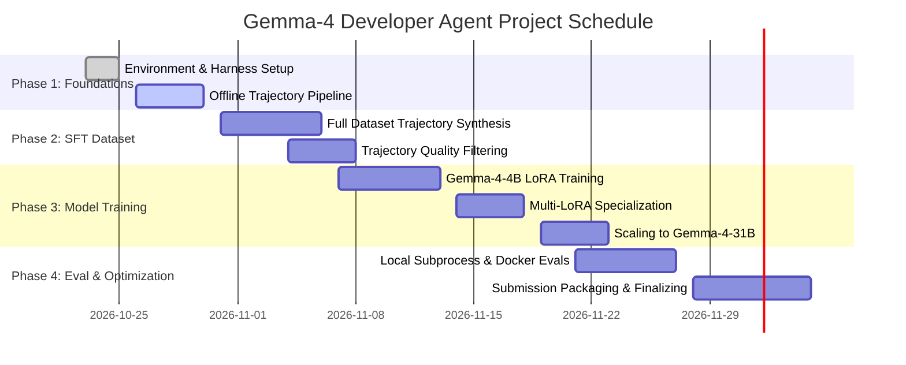

# Gemma-4 Developer Agent: Project Plan & Roadmap

**Date**: October 23, 2026  
**Target Environment**: SWE-bench / `swegemma` Evaluation Harness (Kaggle Competition)  
**Primary Target Models**: `gemma-4-e4b-it-qat-w4a16-ct` (4B testbed & fast iteration) & `gemma-4-31b-it-qat-w4a16-ct` (final competition model)  

---

## 1. Executive Summary & Objective

In this competition, base models do not natively know the repository layout, specific tool interfaces, or optimal navigation strategies for the `swegemma` evaluation harness. The objective is to build a top-performing developer agent system using Google's Gemma 4 model family. 

We will generate offline synthetic Supervised Fine-Tuning (SFT) trajectories from the provided dataset (`tasks.jsonl`, `snapshots/`, `graphs/`, `embeddings/`) and train low-rank LoRA adapters to teach the model:
1. Exact tool syntax and parameter formats (`read_file`, `edit_file`, `write_file`, `submit_patch`, `search_similar_code`, `get_code_neighbors`, `get_code_subgraph`).
2. High-precision 3-tier file editing with unique `old_string` blocks to avoid ambiguity errors.
3. Rapid target file identification without wasteful repository scans.
4. Clean patch submission and avoidance of anti-patterns (e.g. tampering with protected test files).

---

## 2. Synthesis of 3-Hour Study Plan

### Hour 1: The Two-Phase Harness & Tool Mechanics
- **Container Lifecycle**:
  - **Phase 1 (Container A - Agent Sandbox)**: Agent executes tool calls inside `/workspace`. Sandboxed with 4 GiB RAM, 2 vCPUs, air-gapped (`network_mode="none"`).
  - **Phase 2 (Container B - Verification Sandbox)**: Fresh container created. Baseline repo extracted at `base_commit`. Protected test edits stripped from `agent_patch`. `agent_patch` applied via 4-pass resilient git apply. Task `test_patch` applied. Hermetic `pytest` run with JUnit XML verification.
- **Protected File Stripping (Section 8.2)**:
  - Any diff touching `test_*.py`, `*_test.py`, `tests/`, `conftest.py`, `pytest.ini`, `pyproject.toml` is stripped from `agent_patch` and forcefully reset in Container B. Agent must fix core source code, never modify tests.
- **Continuation Nudges (Section 5.3)**:
  - If agent outputs plain text without calling a tool or hits token limit mid-tool-call, harness injects continuation nudges (up to 3 consecutive nudges).
  - SFT training trajectories must teach the model to emit tool calls directly and keep chain-of-thought concise to avoid token truncation.
- **3-Tier Matcher for `edit_file` (Section 6.2)**:
  - **Tier 1 (Exact)**: Substring match.
  - **Tier 2 (Flexible)**: Strips whitespace per line and preserves target indentation baseline.
  - **Tier 3 (Regex)**: Splits around code delimiters `( ) : [ ] { } > = <`.
  - If `old_string` matches >1 occurrence, edit fails with `FileEditError`. Training data must supply unique context lines.

### Hour 2: Data Structures for Fine-Tuning
- **`tasks.jsonl` (129 tasks)**:
  - Repositories: `fastapi/fastapi` (67 tasks), `Textualize/rich` (48 tasks), `psf/requests` (13 tasks), `encode/httpx` (1 task).
  - Input: `problem_statement`, `hints_text`.
  - Ground truth target: `patch`.
- **AST Dependency Graphs (`graphs/*.json`)**:
  - NetworkX `MultiDiGraph` schema (`nodes`, `edges`).
  - Nodes include symbol paths (`fastapi.applications.FastAPI`, `fastapi.openapi.utils.get_openapi`) and code text.
  - Edges include relationship types (e.g. `calls`).
- **Code Embeddings (`embeddings/*.npz`)**:
  - 256-dimensional float32 embeddings for all symbol nodes.
  - Powers `search_similar_code(query, k)` using cosine similarity matrix multiplication.
- **Reverse-Engineering Strategy**:
  - For each task, extract modified files from `patch`.
  - Look up target functions/classes in the graph/embedding index.
  - Synthesize realistic multi-turn trajectories:
    `[System Prompt] -> [User Prompt] -> [Thought + Search/Read Tool Call] -> [Tool Result] -> [Thought + Edit Tool Call] -> [Tool Result] -> [Thought + Submit Patch] -> [Final Summary]`.

### Hour 3: Hardware Budget & LoRA Routing Strategy
- **Hardware Constraints**:
  - 4x NVIDIA L4 GPUs (96 GB total VRAM).
  - vLLM serving with tensor parallel size = 4, `max_model_len = 32768`.
- **Submission Limits**:
  - Strict `< 3 GiB` total unpacked size for the submission archive.
  - Single base model rule across all agents (`ALLOWED_MODEL_NAMES`).
- **Multi-LoRA Architecture**:
  - A single base model can serve multiple LoRA adapters via vLLM's `--lora-modules`.
  - LoRA rank sizing: $r=16$ (~110–220 MB per adapter), $r=32$ (~220–450 MB).
  - Multi-agent layout:
    - Root Coder Agent (`agent.yaml` with `adapter: main_lora`).
    - Code Analyzer Sub-Agent (`sub_agents/code_analyzer.yaml` with `adapter: tool_lora`).
  - Total submission size for 2–4 adapters remains well under 1 GB, comfortably inside the 3 GiB budget.

---

## 3. Milestones & Progress Achieved (October 23, 2026)

- [x] **Analyzed Complete Harness Specification**: Thoroughly documented all 10 sections of `HARNESS_README.md`.
- [x] **Verified Dataset & File Linkages**: Verified 129 tasks in `tasks.jsonl`, cross-linking each task to `snapshots/{instance_id}.tgz`, `graphs/{repo}_{base_commit}.json`, and `embeddings/{repo}_{base_commit}.npz`.
- [x] **Implemented & Tested Harness Tool Logic (`scripts/harness_tools.py`)**:
  - Replicated exact 3-tier matcher (`exact`, `flexible` with indentation delta, `regex`).
  - Built `CodeGraph` wrapper for NetworkX symbol lookups (`get_code_neighbors`, `get_code_subgraph`).
  - Built `CodeEmbeddingIndex` wrapper for 256-d cosine similarity search (`search_similar_code`).
  - Built `parse_unified_diff` utility.
  - Verified 100% test pass rate in `tests/test_harness_tools.py`.
- [x] **Configured 4B Model Baseline (`sample_submission_4b/`)**:
  - Created declarative submission configured for `gemma-4-e4b-it-qat-w4a16-ct`.
  - Updated both root agent and sub-agent configurations to satisfy the single base model rule.
- [x] **Built Submission Validator (`scripts/validate_submission.py`)**:
  - Validates root config discovery, total size (<3 GiB), allowed file extensions, `!include` path traversal safety, and single declared model rule.
  - Successfully validated both `sample_submission` (31B) and `sample_submission_4b` (4B).
- [x] **Prototyped Trajectory Generator (`scripts/generate_trajectory.py`)**:
  - Demonstrated end-to-end synthetic trajectory generation for SFT from task instances.

---

## 4. Multi-Week Roadmap



### Week 1 (Oct 23 – Oct 30): Harness Mastering & Trajectory Pipeline
- **Deliverables**:
  1. Complete the trajectory generation script to extract ground-truth file states from `snapshots/`, compute exact `edit_file` chunks, and format into Gemma-4 chat template.
  2. Implement simulated agent environment to run tasks end-to-end locally using subprocess isolation.
  3. Validate token counts of synthetic trajectories to ensure fit within context budget (< 16,384 tokens).

### Week 2 (Oct 31 – Nov 06): SFT Dataset Generation & Data Quality
- **Deliverables**:
  1. Generate trajectories for all 129 training tasks across FastAPI, Rich, Requests, and HTTPX.
  2. Implement data augmentation:
     - Synthetic negative turns (tool errors and recovery).
     - Varying order of tool exploration (symbol search vs direct file read).
     - Multi-turn file edits (breaking large diffs into smaller hunks).
  3. Format data for standard fine-tuning frameworks (Unsloth, Axolotl, or HuggingFace TRL / SFTTrainer).

### Week 3 (Nov 07 – Nov 13): 4B LoRA Training & Validation
- **Deliverables**:
  1. Train first LoRA adapter on `gemma-4-e4b-it` (or quantized QAT equivalent).
  2. Target modules: `q_proj`, `k_proj`, `v_proj`, `o_proj`, `gate_proj`, `up_proj`, `down_proj`.
  3. Rank selection: start with $r=16, \alpha=32$.
  4. Evaluate trained weights on held-out tasks: measure tool call accuracy, valid JSON syntax, and `submit_patch` success rate.

### Week 4 (Nov 14 – Nov 20): Multi-LoRA Specialization & 31B Scaling
- **Deliverables**:
  1. Split tasks into specialized agent roles:
     - **Code Analyzer Agent**: trained to output symbol paths, examine call graphs, and return minimal root-cause summaries.
     - **File Editor Agent**: trained exclusively on `edit_file` / `write_file` precision and minimal surgical edits.
  2. Scale training to `gemma-4-31b-it-qat-w4a16-ct`.
  3. Verify combined multi-LoRA package size is well within the 3 GiB limit.

### Week 5 (Nov 21 – Nov 27): Local Evaluation & Prompt Optimization
- **Deliverables**:
  1. Run automated benchmarks using local evaluation scripts.
  2. Analyze common failure modes:
     - Non-unique `old_string` in `edit_file`.
     - Premature termination without calling `submit_patch`.
     - Modifying protected files.
     - Token truncation on long thoughts.
  3. Tune prompts in `prompts/system.md` and sampling parameters in `configs/sampling.yaml`.

### Week 6 (Nov 28+): Final Packaging & Competition Submission
- **Deliverables**:
  1. Build automated CI check for submission archive.
  2. Validate directory against all competition harness rules (`validate_submission.py`).
  3. Generate final `submission.zip` containing `agent.yaml`, `eval_config.yaml`, `configs/`, `prompts/`, `sub_agents/`, and `adapters/`.
  4. Perform dry-run submission and monitor resolution rate.

---

## 5. Directory Structure & Key Files

```text
gemma-4-developer-agent/
├── HARNESS_README.md               # Official competition harness documentation
├── projectPlan.md                  # This project roadmap & execution plan
├── tasks.jsonl                     # 129 SWE-bench benchmark tasks
├── snapshots/                      # Repository snapshot archives (.tgz)
├── graphs/                         # NetworkX AST symbol graphs (.json)
├── embeddings/                     # Precomputed 256-d node embeddings (.npz)
├── wheels/                         # Offline python wheels cache
├── sample_submission/              # 31B baseline declarative submission
├── sample_submission_4b/           # 4B baseline declarative submission
├── scripts/
│   ├── harness_tools.py            # 3-tier matcher, graph & embedding tools
│   ├── inspect_tasks.py            # Task inspection and repo breakdown
│   ├── generate_trajectory.py      # SFT trajectory generator
│   └── validate_submission.py      # Submission rules & size validator
└── tests/
    └── test_harness_tools.py       # Unit tests for harness tool mechanics
```
